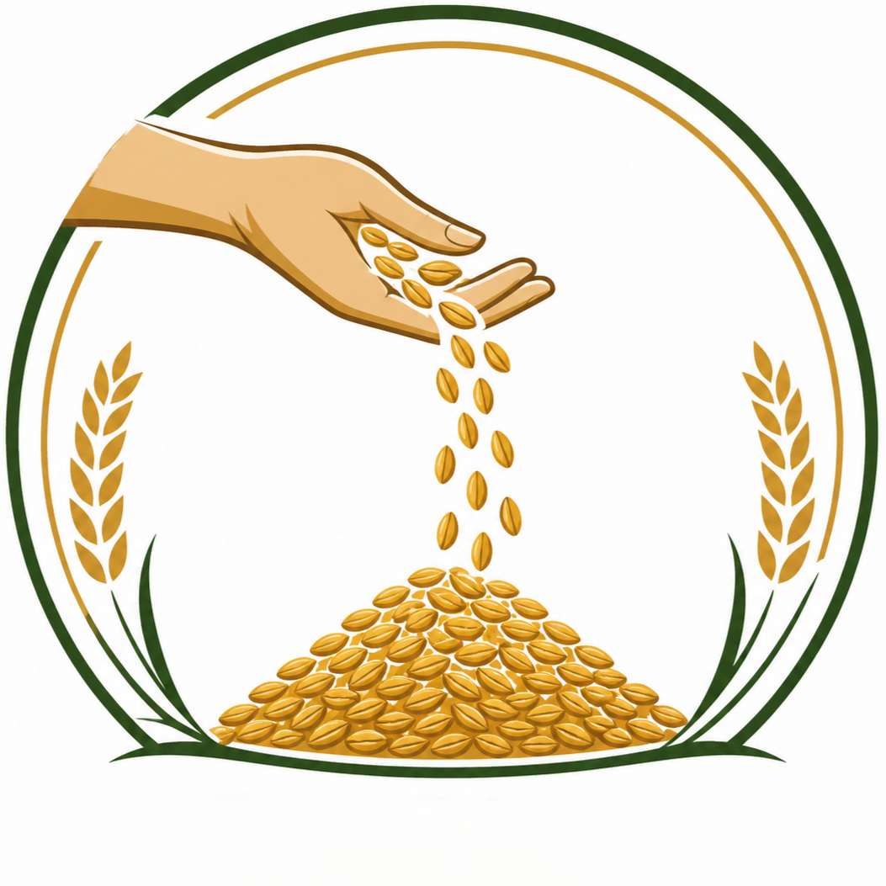

<div align="center">

# 🍚 AnnaPravah

### Smart Public Distribution System — Monitoring & Fraud Prevention Platform

[](https://react.dev/)
[](https://www.typescriptlang.org/)
[](https://vite.dev/)
[](https://tailwindcss.com/)
[](https://supabase.com/)
[](LICENSE)

**🌐 Live Demo:** [annapravah-pds.netlify.app](https://annapravah-pds.netlify.app)



*End-to-end visibility for India's Public Distribution System — from warehouse dispatch to the beneficiary's doorstep.*

</div>

---

## 📖 Overview

The Public Distribution System (PDS) moves millions of tonnes of food grains every month, but monitoring stops at the paperwork. **AnnaPravah** is a full-stack demo platform that tracks every kilogram in transit and every kilogram distributed — and flags fraud the moment it happens.

| The problem | How AnnaPravah solves it |
| --- | --- |
| Stock vanishes between warehouse & shop | Blockchain-style **immutable audit log** + scan-in / scan-out reconciliation |
| Ration distributed to fake or "ghost" beneficiaries | Every distribution requires a **QR-verified ration card** bound to the shop |
| Leaks surface weeks later, in reports | **Real-time dashboards** & fraud alerts generated at the point of transaction |
| Beneficiaries have no visibility | Consumer portal shows **personal entitlement history** and shop stock |

---

## ✨ Features

### 👑 Administrator
- 📊 **Analytics** — distribution trends, variance analysis, monthly reports (Recharts)
- 📦 **Manage Stock** — dispatch inventory to shops, purge & reset demo data
- 🚨 **Fraud Alerts** — triage STOCK_MISMATCH / GHOST_USER / ABNORMAL_SPIKE / CROSS_SHOP alerts
- 👥 **Manage Users** — onboard beneficiaries, dealers; assign cards to shops

### 🏪 Fair Price Shop (Dealer)
- 🏠 **Dashboard** — live shop inventory, pending inbound consignments
- 📥 **Receive Stock** — barcode/QR scan of incoming bags → auto-verifies dispatch vs. receipt, raises mismatch alerts
- 📤 **Distribute Ration** — QR-scan a ration card → entitlements, monthly quota check, one-tap distribution with printed QR receipt

### 🙋 Beneficiary
- 🔍 **Consumer Portal** — scan your ration-card QR to see entitlements & shop stock
- 🧾 **Transaction History** — every issue recorded against your card
- ⚠️ **Report an Issue** — flag theft or non-delivery straight to the admin

### 🔐 Security
- **Row-Level Security** enforced in Postgres — each role sees exactly its own rows ([`supabase_rls.sql`](supabase_rls.sql))
- Anonymous key has **zero table access** (schema usage revoked)
- Cross-shop distribution is **rejected at the database level**
- `audit_log` is **append-only** — writes happen only via `SECURITY DEFINER` triggers

---

## 🛠 Tech Stack

| Layer | Technology |
| --- | --- |
| Frontend | React 19 · TypeScript · Vite 6 · React Router 7 |
| Styling | Tailwind CSS 4 · `clsx` + `tailwind-merge` |
| Animation | Motion (Framer Motion successor) |
| Charts | Recharts |
| QR / Barcodes | `qrcode.react` · `react-barcode` · `html5-qrcode` (camera scan) |
| Backend | Supabase — Postgres, Auth, Realtime |
| Hosting | Netlify (CI from GitHub) |

---

## 🚀 Getting Started

### 1 · Clone & install

```bash
git clone https://github.com/yashcodes22/Annapravah.git
cd Annapravah
npm install
```

### 2 · Configure environment

Create a `.env` in the project root:

```env
VITE_SUPABASE_URL=https://<your-project-ref>.supabase.co
VITE_SUPABASE_ANON_KEY=<your-publishable-key>
```

### 3 · Set up the database

In the Supabase SQL Editor, run **in order**:

1. [`supabase_schema.sql`](supabase_schema.sql) — tables, indexes, audit triggers, seed data
2. [`supabase_rls.sql`](supabase_rls.sql) — role-based Row-Level Security policies

> ⚠️ Always run the RLS file after the schema. The schema enables RLS in fail-closed mode (no policies ⇒ no access).

### 4 · Run

```bash
npm run dev        # http://localhost:5173
npm run build      # type-check + production build
npm run preview    # serve the production build
```

---

## 🔑 Demo Credentials

| Role | Email | Password | You can explore |
| --- | --- | --- | --- |
| Administrator | `admin@pds.gov.in` | `ADMIN@123` | Analytics, stock, alerts, users |
| Dealer — N2001 | `n2001@pds.gov.in` | `Dealer@123` | Punjab Grocery shop |
| Dealer — S2002 | `s2002@pds.gov.in` | `Dealer@123` | South zone shop |
| Dealer — E2003 | `e2003@pds.gov.in` | `Dealer@123` | East zone shop |
| Dealer — W2004 | `w2004@pds.gov.in` | `Dealer@123` | West zone shop |
| Dealer — C2005 | `c2005@pds.gov.in` | `Dealer@123` | Central zone shop |
| Beneficiary | `rp1001@pds.gov.in` | `User@123` | Kapil Singh — R-P1001 |
| Beneficiary | `rk1001@pds.gov.in` | `User@123` | Raju — R-K1001 |
| Beneficiary | `rg1001@pds.gov.in` | `User@123` | Amit — R-G1001 |

> All accounts are seeded demo data — safe to experiment with.

---

## 🗂 Project Structure

```
smart-pds/
├── public/
│   └── _redirects            # Netlify SPA fallback
├── src/
│   ├── components/           # UI building blocks
│   ├── context/
│   │   └── AuthContext.tsx   # Supabase auth + profile/role resolution
│   ├── lib/
│   │   └── supabase.ts       # Client init
│   └── pages/
│       ├── Login.tsx
│       ├── AdminDashboard.tsx / Analytics.tsx / ManageStock.tsx
│       │   / ManageUsers.tsx / FraudAlerts.tsx
│       ├── DealerDashboard.tsx / ReceiveStock.tsx / DistributeRation.tsx
│       └── ConsumerPortal.tsx / BeneficiaryDashboard.tsx
├── supabase_schema.sql       # Tables, triggers, seed data
├── supabase_rls.sql          # Row-Level Security policies
└── netlify.toml              # Deploy config
```

---

## 🔒 Data Model

| Table | Purpose |
| --- | --- |
| `users` | Auth-linked profiles with `role` ∈ admin / dealer / beneficiary |
| `beneficiaries` | Ration cards (`R-P1001`…) with family size & assigned shop |
| `inventory` | Batch-wise stock (`dispatched` → `received` → distributed), QR-serialised |
| `transactions` | Every distribution event, as an immutable JSONB record |
| `stock_receipts` | Scan-in log for inward deliveries |
| `alerts` | Fraud signals raised automatically and by users |
| `grievances` | Beneficiary complaints with SLA tracking |
| `audit_log` | Append-only tamper-proof trail of every write |

---

## 🗺 Roadmap

- [ ] Wire the `grievances` module into the UI (backend & policies already in place)
- [ ] Fix `timestamp` column references in Distribute Ration & Analytics (should be `created_at`)
- [ ] Beneficiary report modal — align with the `alerts` schema
- [ ] Offline-first PWA for low-connectivity shops
- [ ] Aadhaar e-KYC sandbox integration
- [ ] Multi-language UI (हिन्दी, ਪੰਜਾਬੀ, தமிழ்)

---

## 📄 License

Released under the [MIT License](LICENSE).

---

<div align="center">

**Built to demonstrate how transparent, tech-enabled distribution can protect the last mile.**

⭐ Star this repo if you found it useful!

</div>
